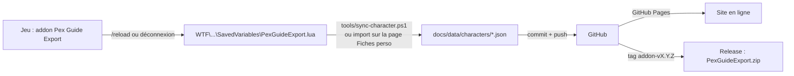

# Forever Pex Guide

Guides de pex, de stuff et fiches de personnages pour **WoW Forever** (serveurs officiels Blizzard, lancement le 4 nov. 2026), tenus par une petite équipe de joueurs.

- **Site** : carnets interactifs par classe et race, fiche de chaque personnage de l'équipe. Publié automatiquement par GitHub Pages depuis le dossier `docs/`.
- **Addon** : `Pex Guide Export` enregistre en jeu la fiche du personnage (stats, équipement, familier, talents, sorts, métiers, quêtes, étape RestedXP) pour mettre le site à jour.
- **Règle d'or** : chaque information a une source datée. Ordre de confiance : Blizzard > jeu > guide d'auteur identifié > base de données > communauté. Un prix ou une coordonnée non vérifiés ne sont pas publiés.

RestedXP reste le guide de quêtes en jeu. Ce projet couvre la classe, le familier, le stuff et les métiers.

## Comment ça marche



## Organisation du dépôt

| Dossier | Contenu |
| --- | --- |
| `docs/` | Le site (GitHub Pages) : accueil, fiches perso, carnets (`docs/guides/<carnet>/`) |
| `docs/data/characters/` | Fiches JSON publiées + `index.json` |
| `docs/assets/` | CSS commun, lecteur SavedVariables (`sv-parser.js`), affichage des fiches |
| `addon/PexGuideExport/` | L'addon WoW (TOC `16001`, Forever 1.60.1) |
| `addon/tests/` | Test de fumée de l'addon avec une API WoW simulée (Lua 5.1 via `lupa`) |
| `guides/` | Notes, sources et versions écrites des carnets (Markdown) |
| `tools/` | Conversion SavedVariables → JSON, validation, scripts Windows d'installation et de synchro |
| `.github/` | CI (tests, lint Lua, validation des données), release de l'addon, modèles d'issues et de PR |

## Démarrage rapide

### Installer l'addon (Windows, PowerShell)

```powershell
.\tools\install-addon.ps1
```

Ou à la main : copier `addon\PexGuideExport` dans `World of Warcraft\_forever_\Interface\AddOns\`. En jeu : `/reload`.

Commandes : `/pge` (photo immédiate), `/pge status` (date de la dernière photo), `/pge reset` (efface la photo du personnage).

### Mettre sa fiche à jour sur le site

1. Jouer normalement : l'addon prend une photo à chaque changement (niveau, équipement, quête, métier…). Jamais en combat.
2. `/reload` ou déconnexion : le jeu écrit `PexGuideExport.lua` sur le disque.
3. Au choix :
   - `.\tools\sync-character.ps1` (Node.js 20+), puis commit + push ;
   - ou la page **Fiches perso** du site → *Importer ma fiche* → *Télécharger le JSON*, à placer dans `docs/data/characters/`.

### Travailler sur le site en local

```bash
npm test             # tests du lecteur SavedVariables
npm run validate     # vérifie les fiches publiées
npm run serve        # site sur http://localhost:8000
```

## Mise en ligne (une seule fois)

1. Dépôt public sur GitHub, branche `main`.
2. *Settings → Pages → Build and deployment → Deploy from a branch* : `main`, dossier `/docs`.
3. *Settings → Collaborators* : inviter les membres de l'équipe.
4. *Settings → Branches* : protéger `main` (pull request obligatoire, CI verte).

## Équipe et contribution

Voir [CONTRIBUTING.md](CONTRIBUTING.md) : branches, pull requests, règles de sources, versions de l'addon. Feuille de route : [ROADMAP.md](ROADMAP.md).

## Licence

Code sous licence MIT. Projet de fans non affilié à Blizzard Entertainment ; World of Warcraft est une marque de Blizzard Entertainment.
