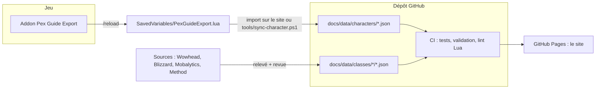

<p align="center">
  
</p>

<p align="center">
  <a href="https://jeancelestinenpalsec.github.io/forever-pex-guide/"></a>
  <a href="https://github.com/JeanCelestinEnpalSec/forever-pex-guide/actions/workflows/ci.yml"></a>
  
  
  <a href="LICENSE"></a>
</p>

<p align="center">
  <b><a href="https://jeancelestinenpalsec.github.io/forever-pex-guide/">Site</a></b> ·
  <b><a href="https://jeancelestinenpalsec.github.io/forever-pex-guide/classes/hunter/">Guide du chasseur</a></b> ·
  <a href="https://jeancelestinenpalsec.github.io/forever-pex-guide/perso/">Fiches perso</a> ·
  <a href="addon/README.md">Addon</a> ·
  <a href="docs/data/README.md">Données</a> ·
  <a href="CONTRIBUTING.md">Contribuer</a> ·
  <a href="ROADMAP.md">Feuille de route</a>
</p>

---

**Forever Pex Guide** est le guide de pex d’une petite équipe de joueurs sur **WoW Forever** (serveurs officiels Blizzard, client français). RestedXP reste le guide de quêtes en jeu ; ce projet couvre tout le reste : talents niveau par niveau, sorts à l’entraîneur, rotation, équipement, familiers, métiers, consommables et macros en français.

Trois principes :

1. **Tout part des données.** Chaque guide de classe est rendu à partir de fichiers JSON relus et validés par la CI. Corriger une info, c’est modifier une ligne.
2. **Chaque info a sa source et sa fiabilité.** Officiel › jeu › base de données (Wowhead) › guide d’auteur (Mobalytics, Method) › équipe › faible. Le site affiche la couleur de fiabilité à côté de chaque section.
3. **Ta fiche vient du jeu.** L’addon *Pex Guide Export* enregistre ton personnage ; le site l’affiche et cale le guide sur ton niveau.

## Ce qu’il y a dedans

| | |
| --- | --- |
| **Guide de classe** ([chasseur](https://jeancelestinenpalsec.github.io/forever-pex-guide/classes/hunter/)) | Curseur « mon niveau » qui recalcule tout : arbres de talents interactifs avec textes français officiels (rang 1 et rang max), ordre des 51 points, sorts par niveau avec priorité, rotation par tranche, armes à distance avec la meilleure à ton niveau, munitions, carquois, familiers, métiers et camp, potions, races, astuces, macros prêtes à copier. |
| **Carnet de personnage** ([Jeanpalsec](https://jeancelestinenpalsec.github.io/forever-pex-guide/guides/chasseur-nain/)) | Le suivi d’un perso précis : priorités du jour avec les vrais prix, PNJ sur la vraie carte, budget. |
| **Fiches perso** ([site](https://jeancelestinenpalsec.github.io/forever-pex-guide/perso/)) | Stats, équipement, familier, talents, métiers, quêtes et étape RestedXP, importés depuis l’addon. L’import reste dans le navigateur. |
| **Addon Pex Guide Export** ([doc](addon/README.md)) | Lecture seule, rien en combat. `/pge`, `/pge status`, `/pge reset`. TOC 16001 (client 1.60.1). |

## Comment ça marche



## Le dépôt en un coup d’œil

```
forever-pex-guide/
├── docs/                      Le site (publié tel quel par GitHub Pages)
│   ├── index.html             Accueil
│   ├── classes/hunter/        Guide de classe (page + rendu JS)
│   ├── guides/chasseur-nain/  Carnet de Jeanpalsec
│   ├── perso/                 Fiches perso + import de l’addon
│   ├── data/
│   │   ├── classes/           Données des guides de classe (JSON, voir docs/data/README.md)
│   │   └── characters/        Fiches publiées (JSON)
│   └── assets/                CSS et JS communs
├── addon/PexGuideExport/      L’addon WoW
├── tools/                     Validation, conversion SavedVariables → JSON, scripts Windows
├── guides/                    Notes et sources des carnets (Markdown)
└── .github/                   CI, release de l’addon, modèles d’issues et de PR
```

## Démarrer

**Je joue et je veux juste le guide** : ouvre le [site](https://jeancelestinenpalsec.github.io/forever-pex-guide/), choisis ta classe, règle ton niveau.

**Je veux ma fiche sur le site** : installe l’addon (copie `addon\PexGuideExport` dans `World of Warcraft\_forever_\Interface\AddOns\` ou lance `tools\install-addon.ps1`), joue, fais `/reload`, puis importe `WTF\Account\<COMPTE>\SavedVariables\PexGuideExport.lua` sur la page Fiches perso.

**Je contribue** :

```bash
git clone https://github.com/JeanCelestinEnpalSec/forever-pex-guide.git
cd forever-pex-guide
npm test            # tests du lecteur SavedVariables
npm run validate    # fiches + données de classe (talents, sources, chemin de pex)
npm run serve       # site sur http://localhost:8000
```

Sous Windows, clone le dépôt **hors de OneDrive** (par exemple `C:\Dev\forever-pex-guide`) : OneDrive et git se marchent dessus. GitHub Desktop fait l’affaire si tu ne veux pas de ligne de commande.

Ensuite : une branche par sujet, une demande de fusion (pull request), une relecture par un autre membre. La CI doit être verte. Tout est détaillé dans [CONTRIBUTING.md](CONTRIBUTING.md) ; pour ajouter une classe, suis [docs/data/README.md](docs/data/README.md).

## Licence

Code sous licence MIT. Projet de fans, non affilié à Blizzard Entertainment ; World of Warcraft est une marque de Blizzard Entertainment. Icônes et infobulles : Wowhead.
